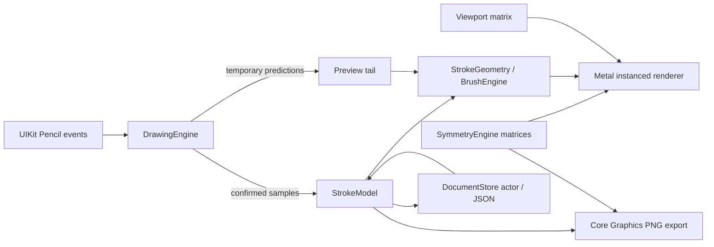

# Phase 1 architecture

The document stores confirmed, stabilized samples in a fixed 2048 × 2048 coordinate system, with pressure, altitude, azimuth, timestamp, brush settings, and frozen radial symmetry per stroke. It stores no rendered bitmap or navigation transform. Existing version 1 brush geometry is retained; version 2 adds pressure choice, stabilization, adaptive tips and storage revisions. Phase 2 can place these strokes inside layers.

## Coordinate contract

`viewPoint = viewport × symmetry × documentPoint`. Incoming points use `inverse(viewport) × preciseTouchLocation`. Pan is in view points, zoom multiplies the fit scale, and rotation is around the canvas center. Gesture focal points are preserved by adjusting pan after zoom or rotation. Bounds changes end the active stroke before using a new mapping.

`Matrix.followed(by:)` explicitly specifies composition order and is shared by symmetry, hit mapping, tests, and export. The Metal renderer consumes those same affine coefficients instead of maintaining a second trigonometric implementation. Vertex coordinates map to normalized device coordinates in view points; MTKView supplies the Retina drawable resolution. Brush width is in document units, so it scales with the artwork.

## Live drawing contract

Only the Pencil touch is selected by default. Navigation recognizers ignore Pencil and pause during Pencil strokes. A testable StrokeSession deduplicates timestamps, stabilizes confirmed input with a time-based low-pass filter, reserves sample/geometry budgets and appends one source stroke. Prediction runs on a copy of filter state and cannot modify confirmed ink. The quadratic builder adds stable sections incrementally; only its last half-segment is replaceable. Finger gesture cancellation removes the tentative stroke and requests persistence of that cancellation.

The CPU tessellates only one source stroke. GPU instancing applies up to 64 radial transforms while drawing. Stable live triangles are sealed into immutable GPU chunks. Only the bounded unsealed chunk and short prediction tail need new uploads each frame. Committed stroke buffers are cached by immutable stroke UUID. Undo removes their cache entries; redo reconstructs them from samples.

At completion, the confirmed tail is added to the cache and the source stroke is committed as one history command. On system touch cancellation, confirmed ink is kept and predictions discarded. An allocation error also retains confirmed input in the document for saving. Identical opaque black overlaps do not darken the result, although rotationally invariant input can still produce redundant triangles. Boundary deduplication is deferred.

## Storage contract

The main actor owns UI/history and an editing generation. Repository writes use a separate monotonically increasing sequence, persisted as storageRevision. The repository rejects stale writes. Atomic primary saves retain a previous valid backup. Atomic journal checkpoints include completed edits and confirmed points of an active stroke. Reopening chooses the highest valid primary/journal revision, then a backup. An old journal left behind by a crash cannot replace a newer primary. Corrupt projects stay visible without blocking others.

A 0.25-second maintenance timer enforces 0.5-second idle and two-second maximum dirty deadlines. During a stroke, a two-second rolling checkpoint includes confirmed input instead of saving a primary without the active stroke. Write duration and OS scheduling can extend these deadlines. Save failure is visible with five-second retries. Closing locks all edit methods and controls, waits for any current primary save and saves the exact edit generation before returning to Gallery. The replaceable thumbnail renders afterward; newer preview requests cancel older pending work, and a repository revision check rejects stale results. An in-flight Core Graphics render can finish before cancellation is observed. Deactivation commits confirmed input and requests a save. Abrupt termination can still lose points after the last completed checkpoint. Undo/redo stacks are session-local.

Gallery loads small metadata indexes when primary size/modification time still match, and uses full decode as fallback. Thumbnails are separate replaceable PNGs. Native project export uses versioned JSON; file import validates it and assigns a fresh project UUID to prevent overwrites.

## Renderer and export boundaries

Document, symmetry, pressure mapping, history, and triangle generation depend on Foundation only. MetalKit and UIKit remain outside the model. Core Graphics replays the same tessellated geometry for PNG output in document coordinates, using one nonzero fill path per instance. Output excludes guides, predictions, viewport navigation, and interface chrome.

The renderer redraws committed chunks for each requested frame and has no tile cache. It now enforces a two-million-source-vertex budget, reconstructs missing meshes off the main actor, and caches paper, translucent guides and symmetry coefficients. Guides are behind artwork. Immutable uploads avoid races with frames already on the GPU. Frame diagnostics expose median/p95 CPU submission, available GPU execution timings, deferred frames and source vertex-buffer bytes; they do not establish touch-to-photon latency or total RAM. Physical-device profiling remains necessary.

## Later phases

Introduce LayerManager with stroke ordering, visibility, locks, opacity, and independent symmetry settings in a versioned document migration. Then extend symmetry with reflections and movable centers, introduce modular brushes and stabilization, and add geometry tools. Tattoo dimensions, references, stencil previews, SVG/PDF, and high-resolution export follow after the core Pencil acceptance checklist passes. No stub controls for those features are shipped in this prototype.
