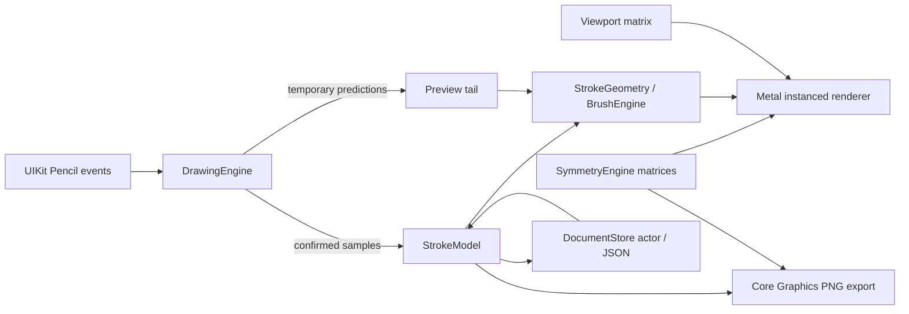

# Drawing architecture — 0.6.0

The document stores confirmed, stabilized samples in a fixed 2048 × 2048 coordinate system, with pressure, altitude, azimuth, timestamp, brush settings, sRGB color, operation, layer membership and frozen radial/mirror symmetry per stroke. Merged layers can additionally store a bounded transparent PNG base; navigation transforms remain transient. Existing version 1 brush geometry is retained; version 2 adds pressure choice, stabilization, adaptive tips and storage revisions. Version 3 adds ordered layers and reflection, version 4 procedural brushes and version 5 sRGB colors and layer group opacity. Legacy drawings decode to one visible, unlocked layer with Mirror off.

## Coordinate contract

`viewPoint = viewport × symmetry × documentPoint`. Incoming points use `inverse(viewport) × preciseTouchLocation`. Pan is in view points, zoom multiplies the fit scale, and rotation is around the canvas center. Gesture focal points are preserved by adjusting pan after zoom or rotation. Bounds changes end the active stroke before using a new mapping.

`Matrix.followed(by:)` explicitly specifies composition order and is shared by symmetry, hit mapping, tests, and export. The Metal renderer consumes those same affine coefficients instead of maintaining a second trigonometric implementation. Vertex coordinates map to normalized device coordinates in view points; MTKView supplies the Retina drawable resolution. Brush width is in document units, so it scales with the artwork.

## Live drawing contract

Only the Pencil touch is selected by default. Navigation recognizers ignore Pencil and pause during Pencil strokes. A testable StrokeSession deduplicates timestamps, stabilizes confirmed input with a time-based low-pass filter, reserves sample/geometry budgets and appends one source stroke. Prediction runs on a copy of filter state and cannot modify confirmed ink. The quadratic builder adds stable sections incrementally; only its last half-segment is replaceable. Finger gesture cancellation removes the tentative stroke and requests persistence of that cancellation.

The CPU tessellates only one source stroke. GPU instancing applies up to 64 rotations or 128 transforms with Mirror while drawing. Reflection is about the horizontal center axis, followed by each radial rotation; guide rays include every resulting reflection axis. Symmetry matrices use an MTLBuffer so the 128-transform case does not depend on the small inline vertex-argument limit. Stable live triangles are sealed into immutable GPU chunks. Only the bounded unsealed chunk and short prediction tail need new uploads each frame. Committed stroke buffers are cached by immutable stroke UUID. Undo removes their cache entries; redo reconstructs them from samples.

## Layers and history

Layer metadata is ordered bottom to top. Source strokes remain in chronological order and reference a layer UUID. The renderer and PNG exporter share the same visible-layer projection. The renderer caches this projection by immutable stroke IDs and visible layer order, so visibility/reorder changes invalidate it without re-tessellating ink. Hidden layers retain their editable data and GPU geometry; locked layers remain visible. Both hidden and locked active layers reject new input. Layer and symmetry changes are frozen during a live stroke.

Stroke history commands retain the full original stroke, including layer and symmetry. Layer actions store copy-on-write snapshots of layers, selection and stroke membership, allowing deletion to restore exact ink and ordering. They do not roll back brush or viewport settings. Adding a stroke or making a structural layer edit clears the redo branch. Layer selection is persisted but is not a history action. Structural snapshots can retain deleted ink until the drawing closes; future memory profiling should account for session history as well as active geometry. Layers use normal compositing. Brush opacity is available on stamped brushes; layer opacity is applied to the isolated group, while alternate blend modes are deferred.

At completion, the confirmed tail is added to the cache and the source stroke is committed as one history command. On system touch cancellation, confirmed ink is kept and predictions discarded. An allocation error also retains confirmed input in the document for saving. Identical opaque black overlaps do not darken the result, although rotationally invariant input can still produce redundant triangles. Boundary deduplication is deferred.

## Storage contract

The main actor owns UI/history and an editing generation. Repository writes use a separate monotonically increasing sequence, persisted as storageRevision. The repository rejects stale writes. Atomic primary saves retain a previous valid backup. Atomic journal checkpoints include completed edits and confirmed points of an active stroke. Reopening chooses the highest valid primary/journal revision, then a backup. An old journal left behind by a crash cannot replace a newer primary. Corrupt projects stay visible without blocking others.

A 0.25-second maintenance timer enforces 0.5-second idle and two-second maximum dirty deadlines. During a stroke, a two-second rolling checkpoint includes confirmed input instead of saving a primary without the active stroke. Write duration and OS scheduling can extend these deadlines. Save failure is visible with five-second retries. Closing locks all edit methods and controls, waits for any current primary save and saves the exact edit generation before returning to Gallery. The replaceable thumbnail renders afterward; newer preview requests cancel older pending work, and a repository revision check rejects stale results. An in-flight Core Graphics render can finish before cancellation is observed. Deactivation commits confirmed input and requests a save. Abrupt termination can still lose points after the last completed checkpoint. Undo/redo stacks are session-local.

Gallery loads small metadata indexes when primary size/modification time still match, and uses full decode as fallback. Thumbnails are separate replaceable PNGs. Native project export uses versioned JSON; file import validates it and assigns a fresh project UUID to prevent overwrites.

## Renderer and export boundaries

Document, symmetry, pressure mapping, history, and triangle generation depend on Foundation only. MetalKit and UIKit remain outside the model. Core Graphics replays the same tessellated geometry for PNG output in document coordinates, using one nonzero fill path per instance. Output excludes guides, predictions, viewport navigation, and interface chrome.

The renderer redraws committed chunks for each requested frame and has no tile cache. It now enforces a two-million-source-vertex budget, reconstructs missing meshes off the main actor, and caches paper, translucent guides and symmetry coefficients. Guides are behind artwork. Immutable uploads avoid races with frames already on the GPU. Frame diagnostics expose median/p95 CPU submission, available GPU execution timings, deferred frames and source vertex-buffer bytes; they do not establish touch-to-photon latency or total RAM. Physical-device profiling remains necessary.

## Later phases

Extend layers with blend modes and optionally per-layer symmetry defaults; current symmetry is frozen per stroke. Movable symmetry centers, imported/custom brushes, additional eraser shapes and geometry tools follow. Tattoo dimensions, references, stencil previews, SVG/PDF, and high-resolution export follow after Pencil/device acceptance. No stub controls for those features are shipped.

## Procedural brushes (0.4.0)

The original quadratic fineliner tessellation remains unchanged, including old geometry versions. Thirteen additional presets include a pressure-enabled ink pen and twelve stamped styles. A Foundation-only arc-length sampler freezes brush parameters per stroke and seeds indexed randomness from its UUID. Live input, predicted copies and document reconstruction use the same sampler. Pricing runs before allocating each confirmed/predicted addition and bounds imported strokes before mesh construction. Stamped brushes emit six Float4 vertices per dab, carrying document and local stamp coordinates; total source GPU geometry is bounded to about 32 MB.

Metal clips circular/elliptical stamps analytically and uses a smoothstep radial opacity falloff for soft shading. Core Graphics exports the identical dab positions, radii, angle and aspect, with a sampled radial gradient of the same falloff. Native UI swatches call this same painter. Stroke opacity accumulates per dab/pass (including overlapping symmetry copies); it is not a layer-opacity setting. Opaque fineliner/brush-pen strokes retain union-path export; invalid transparent legacy ink is rejected.

Document format 4 persists preset, opacity, spacing and density in each brush. Missing brush fields default to the prior fineliner behavior; old stroke geometry and layer migration are retained. Older app versions reject format 4 instead of silently replacing new brush styles with lines.

## Color and isolated layer compositing (0.5.0)

InkColor stores validated sRGB components in Foundation and converts HSB/HEX without a UIKit/SwiftUI dependency. StrokeSession captures color separately from the brush preset; changing presets cannot reset the selected color. Missing fields decode as black/full layer opacity. Format 5 adds the selected color, up to twelve recent colors, per-stroke colors and per-layer opacity. Layer history snapshots coalesce an opacity gesture into one undo command; brush/color settings are outside these snapshots.

Opaque layers retain the direct MSAA drawing path. If any visible layer has opacity strictly between zero and one, Metal first draws paper/guides into the drawable, then resolves each visible layer's MSAA ink into a transparent texture and composites that premultiplied result once using layer opacity. One layer target and one MSAA target are reused sequentially for all layers in a command buffer. A separate nonblocking one-frame gate limits concurrent grouped display work; opaque frames retain the existing three-frame submission gate. Temporary group targets scale with drawable pixel count/sample count rather than layer count and are additional to the source-vertex budget. This path needs actual-device profiling.

Live and predicted ink is inserted with its layer, before higher layers, in both paths. Hidden/zero-opacity layers are omitted. Core Graphics wraps each visible layer in a transparency group with group alpha, preserving overlap behavior in white/transparent PNG and thumbnails. Native brush swatches use the selected stroke color and the same Core Graphics painter.

The locally adapted ColorPickerRing hue ring is MIT-licensed with original attribution and license in ThirdParty/. The ring uses explicit Double/CGFloat trigonometric boundaries, no DynamicColor runtime dependency, a separate original saturation/value square, sliders, HEX and palettes. See FARVER-OG-OPACITY.md for the pinned upstream revision and alternative evaluation.

## Editing and merged raster bases (0.6.0)

InkStroke stores ink/erase and an optional geometry seed. A duplicate gets a fresh stroke UUID for identity/history/cache correctness while retaining its original pattern seed. Legacy strokes use their UUID as the seed. Both real-time and replay samplers use this effective seed.

Erasers use the same bounded geometry/input/symmetry pipeline. Their Metal pipeline uses zero source and one-minus-source-alpha destination blending for RGB/alpha. Any committed/live eraser forces isolated layer rendering so it cannot clear paper or lower layers. Core Graphics uses destination-out inside the same layer transparency group. Ink after an eraser paints normally.

Merge down requires two adjacent visible/unlocked layers and bakes only their composite into a transparent document-sized PNG. The lower layer retains its identity/name and gets a new raster base at full opacity; source strokes from the pair are removed. One structural snapshot supports exact pre-merge Undo before closing. Hidden/locked merge is disabled. Raster validation bounds dimensions/pixels/encoded payload and rejects one raster UUID representing different bytes. Full image decoding is performed in the native layer. Repeated merge/history can retain prior encoded bases until closing, in addition to the active-document budgets; physical memory profiling is required.

Metal uploads premultiplied raster bases with explicit top-left origin and draws a document-sized textured quad before that layer's source strokes. Raster identity participates in canvas preparation, so a merge with zero remaining source strokes still uploads before input resumes. Hidden bases stay cached; pruning removes bases not referenced by the active document. Core Graphics paints the same PNG with an explicit orientation transform.

The pipette runs a one-pixel Core Graphics render at the mapped document pixel with white paper, visible layers/opacity, bases and erasers, excluding guides/navigation/UI. It does not allocate a full-canvas image and returns to brush mode after selecting a color. Layer previews use the export actor, isolated layer content at full opacity and 80-pixel maximum side. SwiftUI tasks are keyed by layer/raster/stroke identity, cancel stale updates and draw checkerboard transparency.
