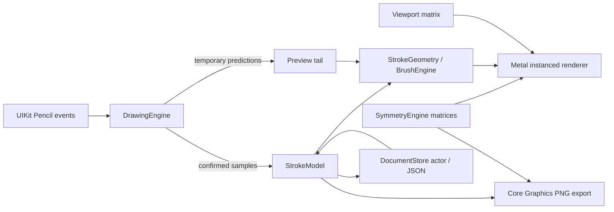

# Phase 1 architecture

The document stores original samples in a fixed 2048 × 2048 coordinate system, with pressure, altitude, azimuth, timestamp, brush settings, and a frozen radial symmetry configuration per stroke. It stores no rendered bitmap and no navigation transform. Phase 2 can place these same strokes inside layers without replacing their geometry.

## Coordinate contract

`viewPoint = viewport × symmetry × documentPoint`. Incoming points use `inverse(viewport) × preciseTouchLocation`. Pan is in view points, zoom multiplies the fit scale, and rotation is around the canvas center. Gesture focal points are preserved by adjusting pan after zoom or rotation. Bounds changes end the active stroke before using a new mapping.

`Matrix.followed(by:)` explicitly specifies composition order and is shared by symmetry, hit mapping, tests, and export. The Metal renderer consumes those same affine coefficients instead of maintaining a second trigonometric implementation. Vertex coordinates map to normalized device coordinates in view points; MTKView supplies the Retina drawable resolution. Brush width is in document units, so it scales with the artwork.

## Live drawing contract

Only the Pencil touch is selected in default mode. Fingers route to navigation; navigation recognizers ignore Pencil and are disabled during an active Pencil stroke. Confirmed coalesced samples append to one source stroke. The midpoint quadratic builder adds stable triangle sections incrementally. Its last half-segment remains replaceable. Prediction geometry starts at that same seam and is discarded on the next event or at stroke completion.

The CPU tessellates only one source stroke. GPU instancing applies up to 64 radial transforms while drawing. Stable live triangles are sealed into immutable GPU chunks. Only the bounded unsealed chunk and short prediction tail need new uploads each frame. Committed stroke buffers are cached by immutable stroke UUID. Undo removes their cache entries; redo reconstructs them from samples.

At completion, the confirmed tail is added to the cache and the source stroke is committed as one history command. On system touch cancellation, confirmed ink is kept and predictions discarded. An allocation error also retains confirmed input in the document for saving. Identical opaque black overlaps do not darken the result, although rotationally invariant input can still produce redundant triangles. Boundary deduplication is deferred.

## Storage contract

The main actor owns document/UI/history state. It sends immutable snapshots with monotonically increasing session generations to a serial repository actor. The repository rejects an older generation after a newer one was saved. It validates before saving, preserves a previous valid primary, and atomically replaces the primary file. A recovery flag tells the UI when a backup was opened. A damaged drawing remains listed so other valid projects are still accessible.

Completed edits debounce for 0.5 seconds. Save errors remain visible. Closing awaits a save and stays in the editor on failure. Deactivation commits confirmed live ink and requests a save, but abrupt termination is not fully journaled. Undo/redo stacks are session state; source strokes persist.

## Renderer and export boundaries

Document, symmetry, pressure mapping, history, and triangle generation depend on Foundation only. MetalKit and UIKit remain outside the model. Core Graphics replays the same tessellated geometry for PNG output in document coordinates, using one nonzero fill path per instance. Output excludes guides, predictions, viewport navigation, and interface chrome.

The current renderer redraws all committed chunks for each requested frame and has no tile cache or global geometry budget. Reopening reconstructs cached meshes on the main thread. These are explicit Phase 1 tradeoffs. A later renderer can add tile/texture caching or replace tessellation without changing persisted samples. Device profiling must establish practical drawing limits before production use.

## Later phases

Introduce LayerManager with stroke ordering, visibility, locks, opacity, and independent symmetry settings in a versioned document migration. Then extend symmetry with reflections and movable centers, introduce modular brushes and stabilization, and add geometry tools. Tattoo dimensions, references, stencil previews, SVG/PDF, and high-resolution export follow after the core Pencil acceptance checklist passes. No stub controls for those features are shipped in this prototype.
